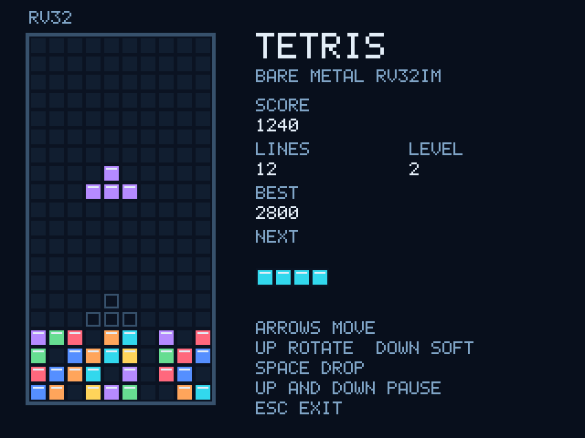

# Virtual RISC-V System-on-Chip (SoC) Emulator

This package contains a complete, software-based emulator for a custom 32-bit RISC-V processor (RV32IM). The project creates a "Virtual SoC" that runs entirely on a host laptop (via WSL2/Linux), bridging hardware design and software simulation without requiring a physical FPGA board.

## Demo & Preview

### Framebuffer Output (Tetris Port)

### Gameplay Demonstration

https://github.com/user-attachments/assets/26db1ab9-469e-4939-86c5-94690ef0941b

## Architecture & Simulation Concept

This emulator operates by simulating the hardware CPU and wiring it to a virtual memory system and display buffer in a C++ environment. It relies on three primary components working together:

1. **The Verilated Master CPU:** 
   The core is a custom 5-stage pipelined RV32I processor with the M-extension, acting as an AXI4-Lite Master. Instead of synthesizing this SystemVerilog RTL for an FPGA, we use **Verilator** to translate the hardware design (`.sv` files) into a cycle-accurate C++ model. 
   This C++ model acts as the "Virtual CPU", for slave to communicate with. 

2. **The C++ AXI4-Lite Slave (`axi_slave.h`):** 
   Because the CPU is now a C++ object, we need simulated memory for it to interact with. The `axi_slave.h` file defines a custom C++ memory model that acts as an AXI4-Lite Slave. It decodes read/write transactions from the CPU and simulates:
   
   - **ROM / RAM:** Memory arrays (`std::vector`) where the compiled RISC-V software binary is loaded and executed.
   - **VRAM (Video RAM):** A dedicated memory space (e.g., mapped to `0x20000000`) acting as the display framebuffer.
   - **MMIO (Memory-Mapped I/O):** Specific hardware addresses that intercept read/write requests to handle things like keyboard input from the host or writing characters to the terminal.

3. **The C++ Wrapper & SDL2 Graphics (`main.cpp`):**
   The `main.cpp` file is the simulation environment wrapper. It creates instances of the Verilated CPU and the AXI Slave. It contains the primary simulation `while` loop that manually toggles the CPU clock signal to drive execution forward.
   
   To achieve visual output, `main.cpp` utilizes the **SDL2 graphics library**. The SDL2 loop acts like a camera continuously pointed at the VRAM array inside the AXI Slave. As the RISC-V software (like Tetris or LVGL) commands the CPU to write pixel data to the VRAM addresses via the AXI bus, SDL2 reads those updated bytes from the C++ array and renders them directly to a physical window on the host's screen.

## Project Structure

- **RTL Modules:**  The RV32IM CPU with AXI4 Lite 
- **C++ Wrappers:** The `main.cpp` execution loop and `axi_slave.h` memory model.
- **Firmware:** The bare-metal C software (e.g., the Tetris game logic) compiled for the RISC-V target using the `riscv-gnu-toolchain`.
- **Concept:** The virtual CPU master drives its AXI output variables to initiate a memory request. The main.cpp wrapper then acts as the physical bus, reading those signal changes on every simulated clock tick and passing them directly into the slave's evaluation functions to be processed.

By compiling the bare-metal C game code, passing the binary to the C++ emulator's memory loader, and running the Verilator simulation, the virtual RISC-V CPU
boots, executes the game logic, and outputs graphics to the SDL2 host window.

## References
- [Verilator Manual](https://verilator.org/guide/latest/exe_verilator.html)
- [SDL2 Documentation](https://wiki.libsdl.org/SDL2/MigrationGuide)
